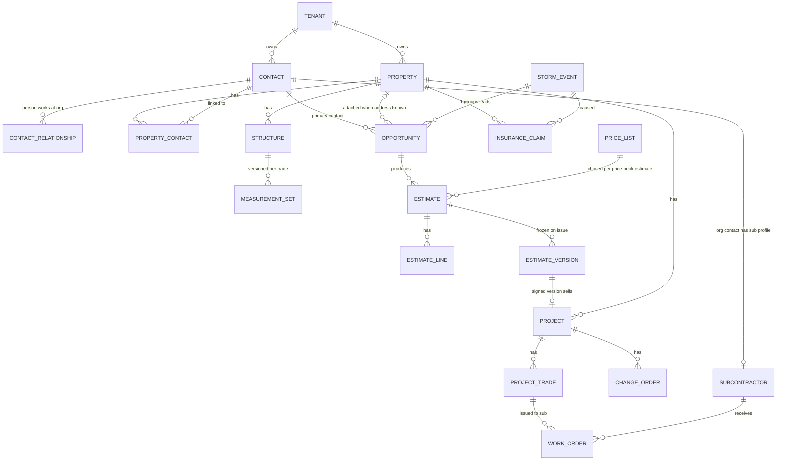

# OES4 Database Schema (Draft v1)

**Status:** draft for review, 2026-11-16.
- Built from [oes4-design-decisions.md](oes4-design-decisions.md) and the OES3 audit.
- Columns are the important ones, not an exhaustive list.
- Final types come from the EF Core model.
- Target database: MySQL 9.6.

---

## 0. Conventions

| Topic | Rule |
|---|---|
| Primary keys | `Id` = **GUID v7** (time-ordered), stored as `BINARY(16)`. Mobile apps can create records offline without ID clashes, and IDs can't be guessed or enumerated the way OES3's integers can. |
| Human numbers | Separate per-tenant sequences for display numbers (`EST-1042`, `P-2026-0311`, `WO-…`), issued from a `tenant_sequences` table inside the same transaction |
| Tenancy | Every tenant-owned table has `TenantId` (NOT NULL, indexed first in every composite index). EF Core global query filter + a save interceptor that stamps and verifies it. Platform tables (carriers, permissions) have no `TenantId`. |
| Audit columns | `CreatedAt`, `CreatedBy`, `UpdatedAt`, `UpdatedBy` on all business tables. Times are `DATETIME(6)` in **UTC**; display uses the tenant's or user's IANA time zone. |
| Concurrency | `RowVersion` on records people edit at the same time (estimates, lines, projects, trades, work orders) |
| Deletes | Business records **archive** (`ArchivedAt`, `ArchivedBy`) instead of deleting. Link rows end with dates instead of being deleted. Hard delete only for drafts and child rows. |
| Money / qty | Money `DECIMAL(12,2)`; unit prices `DECIMAL(12,4)`; quantities `DECIMAL(14,4)`; percentages `DECIMAL(7,4)` |
| Enums | Stored as short strings (readable in SQL, safe to add values) |
| Polymorphic references | `(EntityType, EntityId)` pairs only on link tables (notes, documents, activity, tasks), never as the main relationships |
| Lookups | Rows with behavior get their own table (pipeline stages, workflow stages, trade types). Simple pick-lists share one `lookup_values` table (type + key + label + sort + color + active + isSystem). |
| Secrets | Encrypted at the application layer (ASP.NET Data Protection). Never returned to the UI. |

---

## 1. Platform and tenancy

| Table | Key columns | Notes |
|---|---|---|
| `tenants` | Name, LegalName, Slug, Status (trial/active/suspended), TimeZone (IANA), Country, PlanCode, CreatedAt | Status = trial/active/suspended. One row per contractor company. |
| `tenant_profiles` | TenantId, address, phone, email, website, license numbers, logo DocumentId, brand colors, proposal terms (rich text), letter signer | Used for branding, PDFs, CAN-SPAM footer, merge fields |
| `tenant_settings` | TenantId, Key, Value, IsSecret | Typed settings. Secrets are encrypted. |
| `tenant_sequences` | TenantId, SequenceKey, NextValue, Format | Estimate, project and WO numbers |
| `users` | ASP.NET Identity user (email = login), name, phone, photo, MFA, lockout | **Global**: one login can belong to several tenants |
| `tenant_memberships` | TenantId, UserId, Status (invited/active/disabled), Title, PhotoDocumentId, Signature fields, BookingSlug, Ms365Mailbox, DefaultTimeZone | Per-tenant user profile |
| `roles` | TenantId, Key, Name, IsSystem | Seeded with admin, sales_mgr, sales_rep, production_mgr, production_rep, finance_mgr |
| `permissions` | Key, Group, Description | **Platform**, defined in code and synced at startup |
| `role_permissions` | RoleId, PermissionKey | |
| `membership_roles` | MembershipId, RoleId | Multi-role: effective permissions are the union of the roles |
| `invitations` | TenantId, Email, RoleIds, TokenHash, ExpiresAt, AcceptedAt | |
| `audit_log` | TenantId, ActorUserId, Action, EntityType, EntityId, ChangesJson, Ip, At | Security and admin changes (roles, settings, exports, deletes) |
| `device_tokens` | UserId, TenantId, Platform (ios/android), Token, LastSeenAt | Push notifications |
| OpenIddict tables | applications, authorizations, scopes, tokens | Mobile OAuth2 |
| `external_access_tokens` | TenantId, Purpose (sub_portal/booking_manage/unsubscribe/...), EntityType, EntityId, TokenHash, ExpiresAt, RevokedAt, LastUsedAt | One hashed, expiring, revocable token pattern for every public link |

## 2. Lookups (per tenant, seeded from platform defaults)

- **`lookup_values`** types:
  - lead_source, contact_role_property (owner, tenant, property manager, agent, …), contact_role_project (insured, decision maker, billing, …)
  - lost_reason, document_category, appointment_type, project_type, peril (hail, wind, fire, water, …)
  - subcontractor_doc_type, payment_method, removal_reason
- **`trade_types`**: Name, Code, MeasurementMode (roof/elevation/none), Color, Icon, Sort. Behavior keys off `Code` and `MeasurementMode`, never the name.
- **`pipeline_stages`** (opportunities): Name, Sort, Color, StaleAfterHours, Outcome (open/won/lost), IsDefault.
- **`dispositions`** (call outcomes): Name, RecycleDays, MovesToStageId, CountsAsAttempt, IsDoNotContact.
- **`workflow_stages`**: Level (project/trade), Name, Sort, Color, **Role** (initial, production_start, materials_ordered, materials_delivered, labor, closeout_docs, final_walkthrough, complete, invoiced, paid, closed), GatesJson (e.g. requires material date / work date / subcontractor), StaleAfterDays.

## 3. Contacts

| Table | Key columns | Notes |
|---|---|---|
| `contacts` | TenantId, **Type (person/organization)**, FirstName, LastName, OrganizationName, DisplayName (computed), Status (lead/customer/past_customer, derived), OwnerUserId, SourceKey, IsVendor, CautionFlag + note, Industry/SIC (orgs) | Replaces consumers + companies + company_contacts |
| `contact_methods` | ContactId, Kind (email/phone/mobile/fax/website), Value, NormalizedValue, Label, IsPrimary | Many emails and phones per contact. `NormalizedValue` is indexed for email/SMS/webhook matching. |
| `contact_addresses` | ContactId, Kind (mailing/billing), address fields | A contact's own mailing address, separate from the properties they're tied to |
| `contact_relationships` | PersonContactId, OrganizationContactId, Title, IsPrimary, StartedOn, EndedOn | Person ↔ organization. One person can belong to several orgs. |
| `contact_consents` | ContactId, Channel (email/sms/call), Purpose (marketing/transactional), Status (opted_in/opted_out/unknown), Source, At, Evidence | Required for SMS (STOP/HELP, A2P) and blasts |
| `suppressions` | TenantId, Channel, Address (normalized), Scope (marketing/all), Reason (unsubscribe/bounce/complaint/manual/stop), At, RemovedAt | Checked on every send, including CC/BCC |

## 4. Properties, structures, measurements

| Table | Key columns | Notes |
|---|---|---|
| `properties` | TenantId, address fields, **NormalizedKey** (unique per tenant), Lat, Lng, PropertyKind (residential/commercial/multi_family), ParentPropertyId (campus), Notes | **Root record.** Created at intake or when an address is first captured, with duplicate/near-match check. Has a merge tool. |
| `property_contacts` | PropertyId, ContactId, RoleKey, IsPrimary, StartedOn, EndedOn | Many-to-many with history (house sold → end date) |
| `property_structures` | PropertyId, Name (Main House, Detached Garage, Bldg B), Kind, Sort | Shared by measurements and price-book estimate areas |
| `measurement_field_defs` | TenantId, TradeTypeId, Key, Label, Unit, Group, Mode (roof/elevation/opening), Sort | Generalizes OES3 `trade_measure_fields` to roofing too |
| `measurement_sets` | PropertyId, StructureId, TradeTypeId, VersionNo, IsCurrent, Source (manual/eagleview/hover/quickmeasure/xactimate/ai_extract/other), SourceDocumentId, ExtractionJson, MeasuredOn, MeasuredBy, SupersedesId, Notes | **Never overwritten.** A new report means a new version. The source PDF is always kept. |
| `measurement_values` | SetId, SurfaceKey (roof, front, rear, left, right, facet n), FieldKey, Value | |
| `measurement_openings` | SetId, SurfaceKey, Kind (window/double_window/door/garage_door), WidthIn, HeightIn, Qty | Siding |

The **standalone Measurements page** works on these tables directly. Jobs and estimates reference a set; they don't copy it.

## 5. Opportunities (sales pipeline)

| Table | Key columns | Notes |
|---|---|---|
| `opportunities` | TenantId, Number, Name, **PrimaryContactId** (required), **PropertyId (nullable)**, OwnerUserId, SourceKey, StageId, Outcome (open/won/lost/recycled), LostReasonKey, ExpectedValue, IsInsurance, PerilKey, DateOfLoss, StormEventId (nullable), ContactAttempts, LastContactAt, LastDispositionId, RecycleAt, LockedBy, LockedAt, WonAt, ClosedAt | **A lead is an opportunity.** It can exist without a property; it attaches to one (existing or new) when the address is collected. |
| `opportunity_contacts` | OpportunityId, ContactId, RoleKey | Spouse, property manager, public adjuster… |
| `opportunity_stage_history` | OpportunityId, FromStageId, ToStageId, DispositionId, ByUserId, At, Note | Stale detection and conversion reports |
| `saved_views` | TenantId, UserId (null = shared), ListKey, Name, CriteriaJson, SortJson, IsDefault | Saved filters on every list |
| `campaigns` | TenantId, Name, EntityKind, CriteriaJson, Mode (dynamic/static) + `campaign_members` | Lead banks. Static lists track progress (OES3 campaigns were filters only). |

**Converting:** a won opportunity creates/links an estimate and later a project at its property. A contact can have many opportunities over time.

## 6. Insurance (storm restoration first)

| Table | Key columns | Notes |
|---|---|---|
| `carriers` | **Platform** default list: name, phones, claims email/fax, preferred submission, address, website | |
| `tenant_carriers` | TenantId, CarrierId (nullable = tenant-only carrier), override fields, Notes, IsHidden | The tenant's editable copy. Effective carrier = default ⊕ overrides. |
| `storm_events` | TenantId, Name (e.g. "May 14 2026 hail – North Metro"), EventDate, PerilKey (hail/wind/tornado…), MaxHailSizeIn, MaxWindMph, AreaGeoJson (nullable), ZipCodes (nullable), Source (manual; import later), Notes, ArchivedAt | **Decided 2026-11-16.** A first-class storm record. Opportunities, claims and properties-in-area can be grouped, reported and blasted by storm. HailRecon/IHM imports fill it later. |
| `insurance_claims` | TenantId, PropertyId, OpportunityId, TenantCarrierId, StormEventId (nullable), ClaimNumber, PolicyNumber, DateOfLoss, PerilKey, Deductible, AdjusterContactId, DeskAdjusterContactId, Status (not_filed/open/approved/denied/closed), Notes | First-class claim record (OES3 kept these fields on the project). Shared by the opportunity, estimates, project and supplements. **Optional (decided 2026-11-16):** an insurance opportunity can leave claim fields empty; the claim record is created when the homeowner files, and any field can stay blank until known. |
| `supplements` | TenantId, ClaimId, ProjectId, Status (needed/sent/approved/denied/partial), Reason, RequestedAmount, ApprovedAmount, SentAt, RespondedAt, SubmittedBy, DocumentId | Request history (OES3 had a cover sheet only). Line-level reconciliation spec later. |

## 7. Catalog and price lists

| Table | Key columns | Notes |
|---|---|---|
| `catalog_categories` | TenantId, Code (RFG, SDG…), Name, TradeTypeId | |
| `catalog_items` | TenantId, CategoryId, Code, Description, Unit, IsCore, IsMisc, CoverageNotes, Active | What an item **is**. Doesn't hold prices. |
| `price_lists` | TenantId, Name, RegionCode, EffectiveDate, Source (manual/import), SourceDocumentId, Status (draft/active/archived), Notes | **Many per tenant**, chosen per estimate |
| `price_list_items` | PriceListId, CatalogItemId, Activity (replace/remove/r_and_r/install/material/labor/''), UnitPrice, MaterialPrice, LaborPrice, EquipmentPrice | Unique (PriceListId, CatalogItemId, Activity) |
| `catalog_item_costs` | TenantId, CatalogItemId, Activity, MaterialCost, LaborCost, EquipmentCost, MinimumPrice, EffectiveFrom, EffectiveTo | The tenant's own cost layer, separate from any imported list |
| `price_list_imports` | TenantId, PriceListId, DocumentId, Format (csv/xlsx), MappingJson, Status, RowCounts, ErrorsJson | |
| `products` | TenantId, Sku, Name, Unit, LineType, DefaultCost, DefaultPrice, Supplier, SupplierRef, OptionsJson (colors/sizes), ImageDocumentId, Active | Line-item method and order sheets |
| `catalog_item_products` | CatalogItemId, ProductId | Allowed products per price book item |
| Takeoff engine | `takeoff_rules`, `takeoff_slots`, `takeoff_options`, `takeoff_scope_templates`, `takeoff_coverage_overrides` | Port OES3's structured-rule design (no eval). Keyed by trade type code. Supplier-agnostic. |

## 8. Estimates

| Table | Key columns | Notes |
|---|---|---|
| `estimates` | TenantId, Number, Name, OpportunityId, **PropertyId**, ClaimId, OwnerUserId, **Method (price_book/line_item)**, **PriceListId** (price-book only), Status (draft/issued/sent/signed/declined/expired/shelved), ExpiresOn, ShelvedUntil, OverheadPct, ProfitPct, TaxRate, TaxBasis (materials/all/none), DefaultWastePct, ShowLinePrices, Subtotal/Tax/O&P/Total (cached), CurrentVersionId, SignedVersionId | |
| `estimate_areas` | EstimateId, ParentAreaId, StructureId, Name, Sort | Structure → area tree (Roof, Front Elevation…) |
| `estimate_trades` | EstimateId, TradeTypeId, Description (scope of work text), MeasurementSetId, Sort | |
| `estimate_lines` | EstimateId, AreaId, EstimateTradeId, **Kind** (price_book/product/takeoff/misc/fee/discount), CatalogItemId, Activity, **PriceListItemId** (copied), ProductId, TakeoffRuleId, Description, Qty, Unit, **UnitPrice**, **UnitCost**, **DefaultUnitPrice**, PriceSource (price_list/tenant_min/carrier/manual), IsTaxable, Notes, CarrierLineNo, CarrierDescription, CarrierUnitPrice, ApprovalStatus, Sort | Prices are **copied at add time**. Later price list changes never alter a line. Totals are computed from these lines. No OES3-style "twin" rows. |
| `line_approvals` | LineId, Reason, Status, RequestedBy, DecidedBy (≠ requester), DecidedAt, Note | Approval by exception |
| `estimate_versions` | EstimateId, VersionNo, Status (issued/sent/signed/declined/superseded), IssuedAt/By, RevisionReason, **TermsSnapshot**, TotalsJson, ContentHash, PdfDocumentId, SignedDocumentId, SignedAt, SignerName | Frozen on issue |
| `estimate_version_lines` | VersionId + full copy of the line (incl. unit price, cost, price provenance, area path, product) | Everything needed to reprint or audit |
| `estimate_version_measurements` | VersionId, MeasurementSetId, ValuesJson | Freezes the measurements used |
| `scope_imports` | TenantId, EstimateId, ClaimId, DocumentId, Status, ExtractedJson, CarrierPriceListLabel, ImportedAt | AI carrier scope import |

## 9. Projects and production

| Table | Key columns | Notes |
|---|---|---|
| `projects` | TenantId, Number, Name, **PropertyId**, OpportunityId, ClaimId, ProjectTypeKey, OwnerUserId, StageId, SoldEstimateId, SoldVersionId, ContractValue (cached = signed version + approved COs), InvoiceAmount, JobCost, RemovedAt/By/ReasonKey/Note, ClosedAt | |
| `project_contacts` | ProjectId, ContactId, RoleKey, IsPrimary | Who signed, who pays, who to call |
| `project_trades` | ProjectId, TradeTypeId, StageId, OwnerUserId, Description, MaterialDate, WorkDate, WorkTime, SubcontractorId, Status, Totals (cached), RemovedAt…, StatusBeforeRemoval | |
| `order_sheet_lines` | ProjectTradeId, ProductId, Description, Qty, Unit, UnitCost, Color, Size, SupplierSku, Source (suggested/manual), Delivered | Production materials list. Never affects price. |
| `change_orders` | TenantId, ProjectId, Number, Status (draft/issued/approved/rejected/cancelled), Reason, Amount, IssuedAt, ApprovedAt, PdfDocumentId, SignedDocumentId | |
| `change_order_lines` | ChangeOrderId, Action (add/remove/modify), same line shape as estimate lines | Same line model as estimates |
| `stage_history` | TenantId, Level, ProjectId, ProjectTradeId, FromStageId, ToStageId, ByUserId, At, Note | |
| `automation_rules` | TenantId, Trigger (stage_role_entered/project_created/work_date_set/all_trades_complete/…), StageRole, ActionsJson (email/sms template, task, notify role, document), Enabled | Keyed by role, not stage names |
| `automation_runs` | RuleId, EntityType, EntityId, TriggerKey (dedupe), Status (done/skipped_by_user/failed), DetailJson, At | Prevents re-firing when a stage is re-entered |
| `project_role_assignments` | ProjectId, RoleId, UserId | Sticky role-based assignment |

## 10. Subcontractors and work orders

| Table | Key columns | Notes |
|---|---|---|
| `subcontractors` | TenantId, ContactId (organization contact), Specialties, Status, InsuranceExpiresOn (cached), Notes | Reuses contacts for name, phone and email |
| `subcontractor_documents` | SubcontractorId, DocTypeKey, DocumentId, ExpiresOn | Expiring-insurance alerts; optional scheduling block |
| `subcontractor_rates` | SubcontractorId, Basis (driver/catalog_item), DriverKey, CatalogItemId, Activity, RateBasis (labor_only/installed), Rate, EffectiveFrom, EffectiveTo | Effective-dated, never edited in place |
| `work_orders` | TenantId, Number, ProjectTradeId, SubcontractorId, Status (draft/issued/completed/closed/paid/cancelled), AcceptStatus, AcceptedName/At, OriginalAmount, AuthorizedAmount, FinalAmount, WorkDate, ArrivalTime, IssuedAt, PdfDocumentId | |
| `work_order_lines` | WorkOrderId, EstimateVersionLineId, Description, Qty, Unit, Rate, Amount, IsIncluded | |
| `work_order_requests` | WorkOrderId, **Kind (change/pay/date)**, Status (pending/approved/declined), Amount, ProposedDate, Description, SubmittedAt, DecidedBy/At, Note | One table for the three request types |
| `work_order_request_photos` | RequestId, DocumentId | |
| `work_order_invoices` | WorkOrderId, InvoiceNo, Amount, DocumentId, ReceivedOn | |
| `work_order_payments` | WorkOrderId, Amount, MethodKey, Reference, PaidOn | In a transaction, can't exceed the amount due |

The sub portal uses `external_access_tokens` (purpose `sub_portal`): hashed, expiring, rotatable, and emailed or texted to the sub automatically.

## 11. Notes, documents, activity (multi-level linking)

| Table | Key columns | Notes |
|---|---|---|
| `notes` | TenantId, Body, AuthorUserId, IsPinned, EditedAt | |
| `documents` | TenantId, **StorageKey** (for `IFileStore`), FileName, ContentType, SizeBytes, Sha256, CategoryKey, Source (upload/generated/email/portal/import), UploadedBy | Never web-served directly |
| `generated_documents` | DocumentId, DocType (proposal/sow/…), EntityType, EntityId, VersionId, TemplateVersion | A registry, so the "Later" documents plug in |
| `activity_events` | TenantId, EventType, ActorUserId, Summary, DataJson, OccurredAt | |
| `record_links` | TenantId, **ItemType (note/document/activity/task/email/sms/appointment)**, ItemId, EntityType (property/contact/opportunity/estimate/project/trade/claim/work_order), EntityId, IsPrimary | **One link table for rollups.** A trade note is written with links to trade, project, property and the primary contact. Each view filters "this record" vs "everything under it" with an index lookup, not OES3-style UNION queries. |

## 12. Tasks, calendar, booking

| Table | Key columns | Notes |
|---|---|---|
| `tasks` | TenantId, Title, Notes, DueAt (UTC), HasDueTime, Priority (normal/high), AssignedToUserId, CreatedByUserId, CompletedAt/By, EntityType/EntityId (home record) | Linked via `record_links` for rollups. **Built in M8**; low/urgent priorities and a status column were dropped (open = no CompletedAt) |
| `appointments` | TenantId, Title, TypeKey, StartAt, EndAt (UTC), IsAllDay, TimeZone, Location, AssignedTo, Status, RemoteEventId, RemoteChangeKey, SyncStatus | **Built in M8** without IsAllDay, TimeZone (the tenant zone is used) and the sync columns, which come with M365 sync |
| `appointment_attendees` | AppointmentId, UserId / ContactId / Email, Response | No more JSON text and LIKE matching |
| `calendar_connections` | MembershipId, Provider (ms365), DeltaToken, LastSyncAt, Status, LastError | |
| `busy_calendars` + `busy_blocks` | MembershipId, Label, IcsUrl (encrypted), ShowOnCalendar / StartAt, EndAt | Fetched through an SSRF-safe client |
| `booking_types` | TenantId, Slug, Name, Duration, LocationKind, Buffers, MinNoticeMins, DaysAhead, SlotInterval, DailyCap, AssignmentMode, AsksAddress, CreatesOpportunity, QuestionsJson, IsPublic | |
| `booking_type_hosts`, `availability_rules` | Weekly hours per host, in the host's time zone | |
| `bookings` | TenantId, BookingTypeId, HostUserId, AppointmentId, OpportunityId, ContactId (matched, or a review queue), Name, Email, Phone, Answers, Status, RescheduleCount, SourceIp | Anonymous bookings never write onto existing contacts directly. Matches go to staff review. |

## 13. Communication

| Table | Key columns | Notes |
|---|---|---|
| `mail_accounts` | MembershipId, Provider (ms365), Address, DeltaToken, LastSyncAt, Status | The tenant user's own mailbox |
| `email_messages` | TenantId, MailAccountId, ProviderMessageId (unique per account), ConversationId, InReplyTo, Direction, From, Subject, BodyDocumentId or BodyHtml, Preview, SentAt, BlastId | **One row per message**, linked to many records via `record_links` (OES3 duplicated the row per record) |
| `email_recipients` | MessageId, Kind (to/cc/bcc), Address, ContactId | |
| `email_attachments` | MessageId, DocumentId | |
| `sms_messages` | TenantId, ProviderSid, Direction, FromNumber, ToNumber, Body, Status, MediaJson, At | Linked via `record_links` |
| `phone_numbers` | TenantId, Provider (twilio), Number, MessagingServiceSid, A2PStatus | Inbound webhooks route to the tenant by "To" number |
| `templates` | TenantId, Channel (email/sms), Name, Subject, Body, MergeFieldsJson, Category (marketing/transactional), Active | One merge-field resolver for email, SMS and PDFs |
| `blasts` | TenantId, Name, AudienceJson, TemplateId, SenderMailAccountId (verified), ThrottlePerMin, Status, ScheduledAt, Counters | Sender must be a mailbox the tenant actually owns |
| `blast_recipients` | BlastId, ContactId, Address, Status, ClaimedAt, SentAt, Error | `ClaimedAt` prevents double sends |
| `notifications` | TenantId, UserId, Type, Title, Body, EntityType, EntityId, DedupeKey, ReadAt, EmailedAt, PushedAt | **Built in M8** as UserId, Kind, Title, Body, Url (app-relative only), ReadAt; dedupe and email/push columns come with delivery |
| `notification_preferences` | MembershipId, Type, InApp, Email, Push | |
| `system_email_log` | To, TemplateKey, SesMessageId, Status, At | Platform mail via **Amazon SES** (resets, invites, staff alerts) |

## 14. Nurture

`sequences` (TenantId, Name, AppliesTo (contact/opportunity), Active, StopOnReply, StopOnWon), `sequence_steps` (Order, Kind (email/sms/task/wait), DelayMinutes, ConfigJson), `enrollments` (Status, CurrentStep, NextRunAt, EnrolledBy), `enrollment_step_runs` (Status, Attempt, Detail, At). Retries with backoff. Consent and suppression are checked before every send.

## 15. AI assistant

`ai_conversations` (TenantId, UserId, EntityType, EntityId, FocusId, Model, SystemPromptHash, CostCents), `ai_messages`, `ai_tool_calls` (tool, input, output summary, authorized: yes/no), `ai_drafts`, `ai_knowledge_docs` + `ai_knowledge_chunks` (per tenant), `ai_usage_daily` (TenantId, UserId, Date, CostCents). Limits are checked per tenant and per user **inside** the tool loop. Every tool call re-checks record access.

## 16. Integrations (built later, tables reserved)

`integration_connections` (TenantId, Provider, Status, SettingsJson, SecretsEncrypted), `webhook_endpoints` (TenantId, Provider, PathToken, SecretEncrypted), `webhook_events` (EndpointId, ExternalEventId **unique**, PayloadJson, Status, ReceivedAt, ProcessedAt; retention-limited), `inbound_leads` (source, raw, opportunity created). Covers CompanyCam, SRS/RoofHub, QuickBooks, Fixr, RE.ai, IHM and the email lead monitor.

---

## 17. Core relationships

## 18. OES3 → OES4 data migration (JRS = tenant #1)

| OES3 | OES4 |
|---|---|
| `consumers` | `contacts` (person) + `contact_methods` + `contact_addresses` |
| `companies` | `contacts` (organization) + methods/addresses |
| `company_contacts` | `contacts` (person) + `contact_relationships` |
| `properties` (live) + project site addresses | `properties` (re-normalized, de-duplicated, review queue) + `property_contacts` (from projects' consumer/company, role owner) |
| `lead_metadata` + lifecycle on consumers/companies | `opportunities` (one per lead/prospect record; converted customers get a won opportunity per project) |
| `lead_dispositions`, `prospect_statuses` | `dispositions`, `pipeline_stages` |
| project insurance fields | `insurance_claims` + `tenant_carriers` |
| `projects` with `isEstimate=1` | `estimates` (+ lines, versions) |
| `projects` with `isEstimate=0` | `projects` (+ link to the estimate/version they came from) |
| `pricebook_*` | `catalog_*` + **one imported price list** ("JRS Oct 2026") + `catalog_item_costs` |
| `trade_scope_items`, `trade_line_items` | `estimate_lines` / `order_sheet_lines` (twin rows dropped) |
| `property_measurements`, elevations | `measurement_sets` on a default "Main House" structure |
| `notes`, `attachments`, `activity_log` (polymorphic) | `notes` / `documents` / `activity_events` + `record_links` computed from the hierarchy |
| `email_log` (one row per entity) | `email_messages` de-duplicated by message ID + `record_links` |
| work orders, change orders, booking, blasts, AI tables | Direct mapping, with `TenantId` |
| `collections`, commission tables, weather tables | Not migrated (dropped features). Archive export kept. |

## Resolved questions (owner, 2026-11-16)

1. **Project numbering:** `P-2026-0311` style (prefix, year, per-tenant sequence that resets yearly). The same pattern applies to estimates and work orders.
2. **Subcontractors are contacts:** each sub is an organization contact plus a `subcontractors` profile. Subs appear in contact search with a "Subcontractor" filter, and their crew members are person contacts linked to the organization.
3. **Storm events are records:** `storm_events` table (section 6). Opportunities and claims link to a storm. Storm filters are available on lists, reports and blast audiences.
4. **Claims are optional up front:** insurance opportunities may leave claim fields empty until a claim is filed.
